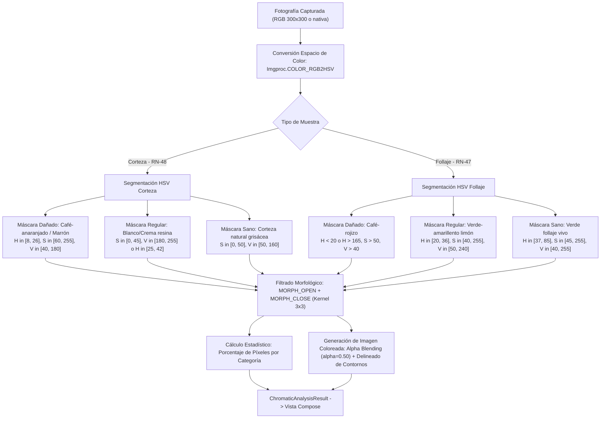

## 1. Descripción del Objetivo

El sistema móvil **EcoVerde** (Android, Jetpack Compose, Material 3, Clean Architecture) captura fotografías de corteza (*árbol individual*) y follaje (*zona macro*) en el Bosque de Chapultepec, realizando inferencia local con TensorFlow Lite y análisis cromático en espacio HSV con OpenCV sin conexión a internet (**RN-46** a **RN-49**).

En el diseño original propuesto en las especificaciones del Trabajo Terminal (**Figura 48** para corteza y **Figura 49** para follaje), la pestaña de **"Análisis de color"** únicamente presentaba barras lineales de progreso con porcentajes de píxeles (`Sano`, `Regular`, `Dañado`, `Incierto`), sin mostrar la fotografía capturada.


Este documento establece la arquitectura limpia (**Clean Architecture**), la ingeniería matemática del algoritmo OpenCV, los modelos de dominio, las interfaces de repositorio y la interfaz declarativa en **Jetpack Compose Material 3** para resolver este requerimiento con máxima fidelidad biológica y rendimiento móvil.

---
## 4. Arquitectura del Sistema (Clean Architecture)

El módulo se estructura respetando la regla de dependencia de Clean Architecture: las capas externas conocen a las internas, pero el núcleo de dominio no tiene ninguna dependencia de Android, Jetpack Compose ni bibliotecas de terceros.

```
mobile/app/src/main/java/com/descortezadores/ecoverde/
│
├── domain/                                      # Capa de Dominio (Kotlin puro)
│   ├── model/
│   │   ├── SampleType.kt                        # CORTEZA, FOLLAJE
│   │   ├── DiagnosticCategory.kt                # SANO, REGULAR, DANADO, INCIERTO
│   │   ├── ColorBandResult.kt                   # Datos de cada franja cromática (categoría, %, color hex, label)
│   │   └── ChromaticAnalysisResult.kt           # Resultado integral: porcentajes, mapa de bandas y rutas de imagen
│   ├── repository/
│   │   └── ImageSegmentationRepository.kt       # Puerto de abstracción para segmentación cromática
│   └── usecase/
│       └── AnalyzeImageColorsUseCase.kt         # Orquesta la segmentación, cálculo estadístico y generación del overlay
│
├── data/                                        # Capa de Datos e Infraestructura
│   ├── segmentation/
│   │   ├── OpenCvColorSegmenter.kt              # Implementación nativa OpenCV (RGB -> HSV, inRange, contornos)
│   │   ├── ColorThresholdsConfig.kt             # Rangos HSV oficiales para Corteza (RN-48) y Follaje (RN-47)
│   │   └── ImageOverlayGenerator.kt             # Composición visual: alpha blending + renderizado de máscaras
│   ├── local/
│   │   ├── entity/AnalisisCromaticoEntity.kt    # Entidad Room para persistencia local offline (RN-50)
│   │   └── dao/AnalisisCromaticoDao.kt          # Operaciones SQLite Room
│   └── repository/
│       └── ImageSegmentationRepositoryImpl.kt   # Implementación del puerto de dominio
│
└── presentation/                                # Capa de Presentación (Compose + Material 3)
    ├── features/analysis/
    │   ├── AnalysisResultViewModel.kt           # Gestión de estado (StateFlow<AnalysisResultUiState>)
    │   ├── AnalysisResultUiState.kt             # Modelos inmutables de UI
    │   ├── AnalysisResultScreen.kt              # Pantalla principal con Tabs [Clasificación] y [Análisis de color]
    │   └── components/
    │       ├── ClassificationTabContent.kt      # Pestaña 1: Figura 47 (sin imagen coloreada)
    │       ├── ColorAnalysisTabContent.kt       # Pestaña 2: Figuras 48 y 49 + NUEVA Imagen Coloreada por Secciones
    │       ├── SegmentedImageCanvas.kt          # Visor interactivo con Zoom/Pan (gestos Compose) y control de opacidad
    │       ├── ColorCategoryFilterChips.kt      # Chips interactivos para aislar franjas (Marrón, Crema, Verde)
    │       └── ChromaticMetricBar.kt            # Barras lineales de distribución cromática (Figuras 48 y 49)
    └── theme/
        ├── Color.kt                             # Paleta Material 3 EcoVerde (GreenPrimary, etc.)
        └── Theme.kt
```

---

## 5. Fundamentación Matemática y Procesamiento Digital con OpenCV

Conforme al Capítulo 4 (§4.2.4) y las reglas **RN-46**, **RN-47** y **RN-48** del Trabajo Terminal, el análisis de color opera en el espacio **HSV** (*Hue, Saturation, Value*) para garantizar invarianza ante cambios de iluminación natural y sombras en el Bosque de Chapultepec.



### Tabla Oficial de Calibración Cromática HSV (OpenCV 8-bit: $H \in [0, 180]$, $S, V \in [0, 255]$)

| Tipo de Muestra | Categoría Diagnóstica | Señal Biológica Asociada | Rango Hue ($H$) | Rango Sat ($S$) | Rango Val ($V$) | Color Representado en Pantalla |
|---|---|---|---|---|---|---|
| **Corteza** | **Dañado** | Exudados café-anaranjados, galerías subcorticales | $8 - 26$ | $60 - 255$ | $40 - 180$ | **Marrón / Café-anaranjado** (`#8B4513`) |
| **Corteza** | **Regular** | Grumos frescos de resina blanca/crema/rojiza | $0 - 180$ (si $S \le 45$) ó $25 - 42$ | $0 - 65$ | $170 - 255$ | **Crema / Blanco-ambarino** (`#E6D7B8` / `#FFC107`) |
| **Corteza** | **Sano** | Corteza natural no colonizada (grisácea/mate) | $0 - 180$ | $0 - 55$ | $50 - 165$ | **Verde bosque / Grisáceo** (`#2D6A3E`) |
| **Corteza** | **Incierto** | Sombras profundas, fondos no leñosos | Resto | Resto | Resto | **Gris translúcido** (`#757575`) |
| **Follaje** | **Dañado** | Tejido necrótico, muerte por falta de savia | $< 20$ ó $> 165$ | $> 50$ | $> 40$ | **Café-rojizo** (`#A52A2A`) |
| **Follaje** | **Regular** | Clorosis, deterioro activo (verde-limón) | $20 - 36$ | $40 - 255$ | $50 - 240$ | **Verde-amarillento limón** (`#9ACD32`) |
| **Follaje** | **Sano** | Clorofila activa, follaje vigoroso | $37 - 85$ | $45 - 255$ | $40 - 255$ | **Verde vivo** (`#2E7D32`) |
| **Follaje** | **Incierto** | Cielo abierto, ramas muertas distantes | Resto | Resto | Resto | **Gris humo** (`#9E9E9E`) |
